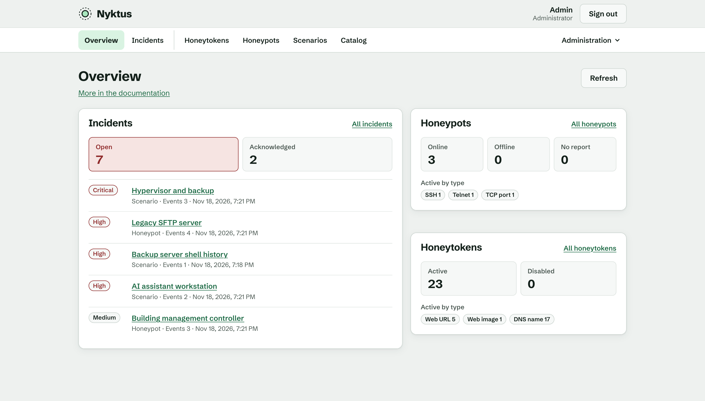

# Nyktus

The open cyber deception platform.

[Documentation](https://docs.nyktus.org) · [Quickstart](https://docs.nyktus.org/getting-started/quickstart) · [Releases](https://github.com/nyktus/nyktus/releases)



## Welcome

Nyktus detects intruders, insider threats and data breaches with believable decoys: honeytokens and honeypots that you place across your infrastructure.

Log-based detection collects everything and searches for the needle afterwards. Deception works the other way round: you place decoys, honeytokens and honeypots, that have no legitimate use. Nobody connects to a decoy SSH server by accident, and nobody resolves a DNS name that only exists inside a backup archive. When a decoy fires, someone is where they should not be.

This makes Nyktus a good fit for teams without a security operations center, and a low-noise source for teams that already run a SIEM.

## Feature highlights

- **Deception catalog.** Ready-made guides turn a story, such as a stolen backup, into a scenario with the honeytokens, honeypots and example files it needs. Every guide is mapped to MITRE ATT&CK techniques and follows the MITRE Engage approach to planning deception.
- **Honeytokens.** URLs, images, QR codes and DNS names that fire when they are requested or resolved.
- **Honeypots.** A lightweight sensor inside your network emulates services such as SSH, PostgreSQL, LDAP or an MCP server and reports every attacker session.
- **Scenarios.** Honeytokens and honeypots grouped into one coherent story.
- **Alerting and API.** Alerts by email, webhook, Slack and Microsoft Teams, and a REST API with an OpenAPI description.
- **Self-hosted.** Run Nyktus under your control on your own infrastructure.

## Getting started

You need Git, Make, OpenSSL and Docker Compose.

```sh
git clone https://github.com/nyktus/nyktus.git
cd nyktus
make dev-up
```

The command builds the images, starts Nyktus with PostgreSQL and prints the setup link of the first administrator. Open it in your browser and create the account. The console runs on http://localhost:8080.

This environment is for evaluation only.
For a production-ready installation, follow the [quickstart](https://docs.nyktus.org/getting-started/quickstart) with the released containers and the [deployment guide](https://docs.nyktus.org/operate/deploy).

## Documentation

The documentation at https://docs.nyktus.org covers the deception concepts, the deployment and operation of Nyktus, and the API reference.

## Design principles

- **Self-hosted and compact.** Your decoy inventory never leaves your infrastructure. There is no telemetry, no phone-home and no external resource loaded at runtime.
- **High precision signal.** A decoy has no legitimate use, so every alert deserves attention.
- **Fits your infrastructure.** Run Nyktus where it suits you: everything on one host, with the container images and the reference Docker Compose setup, or as single binaries for Linux. The server roles (console, worker, trigger and DNS) run in one process or on separate hosts.
- **Secure by default.** Security is a property of the code, not a configuration option. See the [secure coding guidelines](docs/development/secure-coding.md).

## Contributing

Contributions are welcome. Please read [CONTRIBUTING.md](CONTRIBUTING.md) and the [Code of Conduct](CODE_OF_CONDUCT.md) first. CONTRIBUTING.md also describes how to build Nyktus from source and run the binaries yourself.

## Security

Please do not report vulnerabilities through public issues. See [SECURITY.md](SECURITY.md).

## License

Nyktus is licensed under the [GNU Affero General Public License v3.0 or later](LICENSE). The deception catalog in `catalog/` is licensed under CC BY-SA 4.0, with an additional permission that lets you use generated decoys without attribution. Third-party data that Nyktus ships, such as MITRE ATT&CK, is listed with its notices in [NOTICE](NOTICE).

MITRE, ATT&CK and MITRE Engage are trademarks of The MITRE Corporation. Nyktus is not affiliated with or endorsed by MITRE.
